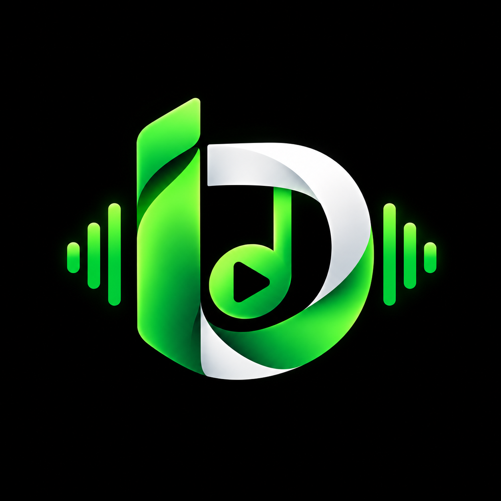

# IDRMUSIC 🎵

<div align="center">



### **Written to be Sung • High-Fidelity Studio Music Streaming & Download Hub**

[](https://github.com/indrajitpadhiyar/IDRMUSIC)
[](https://github.com/indrajitpadhiyar/IDRMUSIC)
[](https://github.com/indrajitpadhiyar/IDRMUSIC)
[](LICENSE)

[🌐 Web App](#-web-application) • [🪟 Windows Desktop](#-windows-desktop-app) • [📱 Android App](#-android-mobile-app) • [🚀 Download Website](#-download-portal-website) • [🛠️ Architecture](#-project-architecture)

</div>

---

## 🌟 Overview

**IDRMUSIC** is an all-in-one music ecosystem featuring studio-grade lossless audio streaming, cloud playlist synchronization, and native applications for **Windows Desktop** and **Android**.

Whether on desktop or mobile, IDRMUSIC delivers a Spotify-grade experience with zero ads, hardware-accelerated audio rendering, and instant offline downloads.

---

## 📱 Multi-Platform Availability

| Platform | Format / Package | Highlights |
| :--- | :--- | :--- |
| **🌐 Web Player** | Web (Vite + React 19) | Instant streaming in any modern browser, Google OAuth, Spotify 3-column layout. |
| **🪟 Windows Desktop** | `IDRMusic-Setup-1.0.0.exe` (Installer)<br>`IDRMusic-Portable-1.0.0.exe` (Portable) | Native desktop integration, system tray, loopback OAuth, hardware sound acceleration. |
| **🤖 Android App** | `IDRMusic.apk` (`in.idrmusic.app`) | Android foreground audio service, lock-screen controls, notification media controls, safe-area support. |
| **🚀 Download Portal** | Animated Download Website | 3 dynamic themes (Dark Studio, Light Ivory, Spotify Green), interactive mockup player, direct download links. |

---

## 🚀 Key Features

- **🎧 Studio Hi-Fi Sound Engine**: Uncompressed 320kbps & 24-bit/48kHz master audio with hardware buffering.
- **📱 Background & Lockscreen Playback**: Android MediaSession integration keeps audio playing smoothly when minimized or locked.
- **☁️ Cloud & Google Drive Streaming**: Stream directly from Google Drive and Supabase storage with automatic caching.
- **📂 Playlist Management**:
  - Add to playlist directly from song cards or Now Playing view.
  - Hover **3-dots menu** on any playlist to **Rename** or **Remove** it in seconds.
- **🔐 Google OAuth 2.0 & Cloud Sync**: Sign in with Google on Web, Desktop, and Android to keep your liked tracks and playback resume timestamps synchronized.
- **🎨 3-Theme Switcher (Download Portal)**:
  - 🌙 **Dark Studio**: Deep onyx with neon cyan & violet accents.
  - ☀️ **Light Ivory**: Crisp studio white with elegant indigo highlights.
  - 🌲 **Spotify Green**: Signature carbon emerald with vibrant `#1ed760` accents.
- **⚡ Zero Installation Portable Build**: Take IDRMusic on a USB stick and run it on any Windows 10/11 PC with zero setup.

---

## 🛠️ Tech Stack

### Frontend & Desktop
- **React 19 & Vite 8**: Ultra-fast component rendering and hot module reloading.
- **Tailwind CSS v4**: Modern CSS architecture with hardware-accelerated animations.
- **Electron 45**: Native Windows desktop runtime.
- **Capacitor 8**: Native Android bridge with foreground audio service.
- **Framer Motion**: Fluid, spring-physics UI transitions.
- **Lucide Icons**: Clean, pixel-perfect icon set.

### Backend Engine
- **Node.js & Express**: High-throughput REST API.
- **MongoDB & Mongoose**: Relational song catalog and user account storage.
- **Redis**: Low-latency caching for instant song searches and query results.
- **Google Drive API**: Audio file streaming and cover art proxy.
- **Supabase Storage**: High-speed CDN media storage.

---

## 📁 Project Architecture

```text
IDRMUSIC/
├── backend/                  # Express REST API & Database Services
│   ├── config/               # Database, Redis & Supabase connections
│   ├── controllers/          # Song, auth, and drive controllers
│   ├── models/               # Mongoose schemas (Song, User, Playlist)
│   ├── routes/               # Express routing endpoints
│   └── server.js             # API entrypoint
│
├── frontend/                 # Core React 19 + Electron + Capacitor Application
│   ├── android/              # Native Android project (Gradle, AndroidManifest)
│   ├── electron/             # Electron main & preload scripts for Windows
│   ├── public/               # Static assets & IDRMusic logo
│   ├── release/              # Compiled Windows (.exe) & Android (.apk) binaries
│   ├── src/
│   │   ├── components/       # Player, Sidebar, Modals, TopBar, Views
│   │   ├── config/           # API and environment configuration
│   │   ├── services/         # API client & Google OAuth handler
│   │   └── App.jsx           # Root layout & state controller
│   └── capacitor.config.json # Capacitor Android configuration
│
├── download_website/         # Official Download Portal Website
│   ├── public/               # Direct download binaries & logo
│   │   ├── IDRMusic.apk      # Standalone Android APK download
│   │   └── release/          # Windows installer & portable binaries
│   └── src/
│       ├── App.jsx           # Animated landing page with 3 themes
│       └── index.css         # Custom animations & sound wave keyframes
│
└── README.md                 # Project documentation
```

---

## 📦 Getting Started

### 1. Clone the Repository
```bash
git clone https://github.com/indrajitpadhiyar/IDRMUSIC.git
cd IDRMUSIC
```

---

### 2. Backend Setup
```bash
cd backend
npm install
cp .env.example .env
# Configure your MongoDB, Redis, and Google Drive credentials in .env
npm run dev
```

---

### 3. Frontend & Desktop Setup
```bash
cd ../frontend
npm install

# Run web app in browser:
npm run dev

# Run desktop app in development:
npm run electron:dev
```

---

### 4. Build Windows Desktop Executables (.EXE)
To generate the Windows installer and portable builds:
```bash
cd frontend
npm run build:installer
```
**Outputs generated in `frontend/release/`:**
- 📦 **Installer**: `IDRMusic-Setup-1.0.0.exe` (~129 MB)
- ⚡ **Portable**: `IDRMusic-Portable-1.0.0.exe` (~116 MB)
- 📂 **Unpacked**: `win-unpacked/IDRMusic.exe`

---

### 5. Build Android APK (.APK)
Prerequisites: JDK 21 LTS and Android SDK.
```bash
cd frontend

# Build frontend and sync with Android native wrapper:
npm run android:build

# Compile the standalone debug APK:
cd android
./gradlew assembleDebug
```
**Output generated:**
- 📱 `frontend/android/app/build/outputs/apk/debug/app-debug.apk` (Copied to `IDRMusic.apk`, ~5.05 MB)

---

### 6. Run the Download Portal Website
```bash
cd download_website
npm install
npm run dev
```
Open `http://localhost:5173` to test the animated download site and verify direct downloads for both Windows and Android.

---

## ⚙️ Environment Variables

### Frontend (`frontend/.env`)
```ini
VITE_API_BASE_URL=https://idrmusicbackend.onrender.com/api
VITE_GOOGLE_CLIENT_ID=your_web_google_client_id.apps.googleusercontent.com
VITE_GOOGLE_CLIENT_ID_DESKTOP=your_desktop_google_client_id.apps.googleusercontent.com
GOOGLE_CLIENT_ID_DESKTOP=your_desktop_google_client_id.apps.googleusercontent.com
GOOGLE_CLIENT_SECRET_DESKTOP=your_desktop_google_client_secret
```

### Backend (`backend/.env`)
```ini
PORT=4000
MONGODB_URI=your_mongodb_connection_string
JWT_SECRET=your_jwt_secret_key
GOOGLE_CLIENT_ID=your_web_google_client_id.apps.googleusercontent.com
GOOGLE_CLIENT_SECRET=your_web_google_client_secret
GOOGLE_CLIENT_ID_DESKTOP=your_desktop_google_client_id.apps.googleusercontent.com
GOOGLE_CLIENT_SECRET_DESKTOP=your_desktop_google_client_secret
GOOGLE_DRIVE_FOLDER_ID=your_google_drive_folder_id
```

---

## 📄 License

This project is licensed under the MIT License — see the [LICENSE](LICENSE) file for details.

---

<div align="center">

**IDRMUSIC** • Designed & Engineered with ❤️ by [Indrajit Padhiyar](https://github.com/indrajitpadhiyar)

</div>
